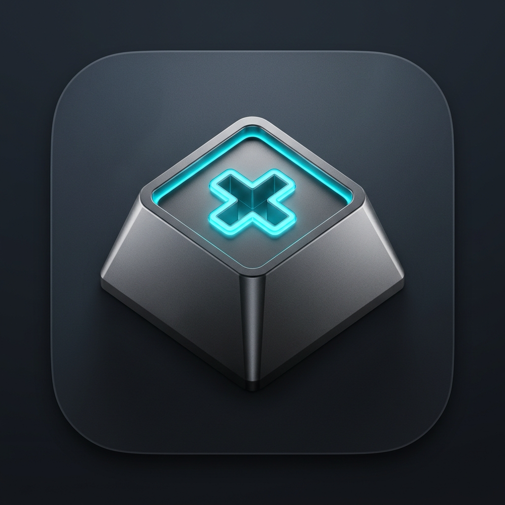

# Klackr

Mechanical keyboard and mouse click sound simulator for macOS and Windows. Klackr plays satisfying tactile keystrokes and microswitch mouse clicks as you type and navigate, running quietly in your menu bar or system tray.

<p align="center">
  
</p>


## Features

- **6 Bundled Mechanical Keyboard Profiles**:
  - Cherry MX Brown (Tactile, warm)
  - Cherry MX Blue (Clicky, sharp)
  - Cherry MX Red (Smooth linear)
  - Cherry MX Black (Heavy vintage linear)
  - Topre Purple Hybrid (Deep electro-capacitive thock)
  - Everglide Oreo (Snappy modern tactile)
- **Mechanical & Optical Mouse Click Sounds**:
  - Classic Omron Microswitch (Dual-stage press & release)
  - Logitech G Pro Superlight (Snappy esports tactile)
  - Razer Optical Switch (Fast punchy actuation)
  - Glorious Model O (Lightweight Kailh click)
  - Silent Office Tactile (Muted soft focus click)
- **Independent Controls**: Toggle keyboard sounds and mouse clicks separately, with individual volume controls for each.
- **In-App Sound Pack Hub**: Preview switches, import custom sound pack folders, reveal your local packs folder in Finder, and browse community packs.
- **Ultra-Low Latency**: Dedicated polyphony player pools for keyboard typing and mouse clicks.
- **Universal Binary (macOS)**: Native Apple Silicon (M1/M2/M3/M4) and Intel x86_64 support.
- **Windows Tray App**: Native C# .NET 8 WASAPI app with global hotkeys and system tray controls.

## Install

### Download

Grab the latest DMG from Releases, open it, and drag **Klackr.app** into Applications.

### Important: First Launch

Since Klackr is built locally or distributed as an ad-hoc / developer-signed app, remove the quarantine attribute before the first launch:

```bash
xattr -cr /Applications/Klackr.app
```

Then open the app normally. Grant **Input Monitoring** permission when prompted (System Settings > Privacy & Security > Input Monitoring).

### Build from Source (macOS)

```bash
git clone https://github.com/vickyjnv/Klackr.git
cd Klackr
make build        # Build the app
make dist-app     # Create signed distribution
make dmg          # Create DMG installer
```

Requires Xcode 16+ and macOS 14+.

---

## Windows Support

Klackr now natively supports **Windows 10 and 11**! See the [`windows/`](windows/README.md) directory.

- **Native C# .NET 8 Tray App**: Ultra low-latency WASAPI audio, system tray controls, global `Alt+Ctrl+K` hotkey, and automatic startup toggle.
- **Standalone Single-File Executable**: Run `windows/build.bat` or `dotnet publish` to build a self-contained `Klackr.exe`.
- **Portable Python Option**: Run immediately with `windows/run_portable.bat`.
- **Automated CI**: GitHub Actions automatically builds `Klackr-Windows-x64.zip` on every push!

### Versioning

Kutuk uses a checked-in versioning script so local releases and CI builds stay in sync.

To update the app version and automatically increment the local build number by 1:

```bash
make bump-version VERSION=1.0.2
```

To increment only the build number:

```bash
make bump-build
```

If needed, you can also set an explicit build number while changing the app version:

```bash
make bump-version VERSION=1.0.2 BUILD=5
```

Release builds set the final build number from GitHub Actions, so shipped artifacts always get a monotonically increasing CI build number.

## Usage

Once running, Kutuk appears as a small icon in your menu bar. Click it to:

- Toggle sounds on/off
- Adjust volume
- Switch sound packs
- Configure the global hotkey
- Set launch at login

## Permissions

Kutuk requires **Input Monitoring** permission to detect keystrokes. It listens in read-only mode and never records, stores, or transmits any keystrokes. You can verify this in the source code — the event tap uses `.listenOnly` mode.

### Granting Permission

1. When prompted, click **Grant Input Monitoring** in the menu
2. Toggle Kutuk **ON** in System Settings > Privacy & Security > Input Monitoring
3. Click **Restart to Apply Permission** in the menu (macOS requires a restart for the permission to take effect)

### Troubleshooting: Multiple Entries in Input Monitoring

If you rebuild from source, macOS may create duplicate Kutuk entries in Input Monitoring. To clean up, open System Settings > Privacy & Security > Input Monitoring, select each old entry, click the **minus (−)** button to remove it, then re-add the current app.

## Contributing

See [CONTRIBUTING.md](CONTRIBUTING.md) for development setup and guidelines.

## License

[MIT](LICENSE)

Bundled Cherry MX Brown and Cherry MX Blue audio is derived from the MIT-licensed
Mechvibes `mxbrown-travel` and `mxblue-travel` sound packs. See
[THIRD_PARTY_NOTICES.md](THIRD_PARTY_NOTICES.md).
